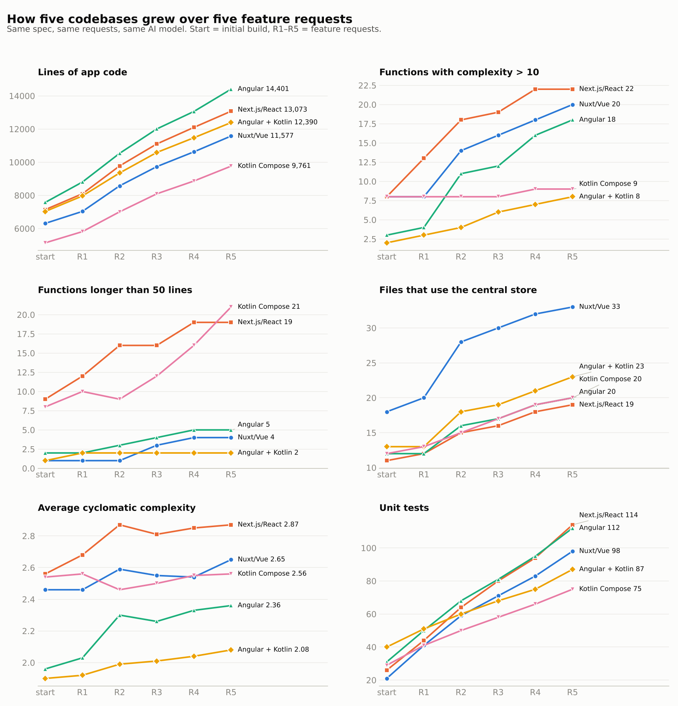
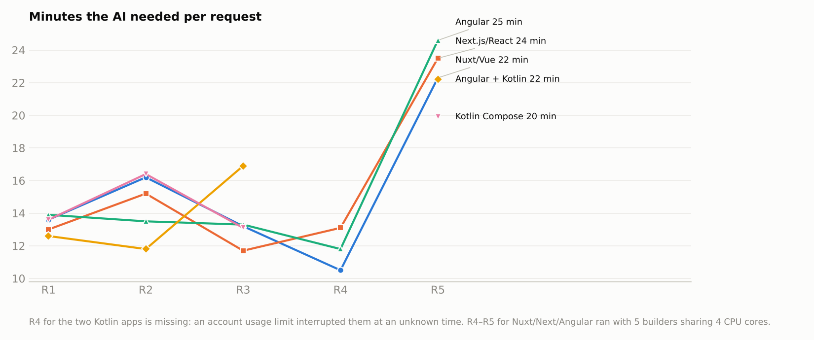
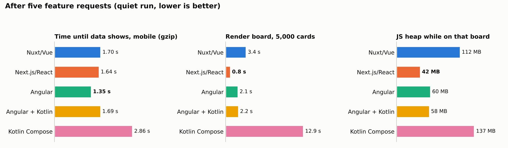

# Growth experiment: how five AI-maintained codebases change over five feature requests

**The question.** When an AI keeps adding features to an app, do the frameworks pick up complexity at the same rate? Does one of them turn into spaghetti?

**The setup.** Five apps were built from the same spec ([`SPEC.md`](../../SPEC.md)). Each was then handed to one AI maintainer: a Claude subagent, one per app, kept for the whole experiment. Each maintainer received the same five feature requests one at a time, word for word ([`requests.md`](requests.md)).

- The maintainers were told they were maintaining the app for a product owner. They were not told it was a test or what was being measured.
- After each request they logged their problems and mistakes in the app's `ISSUES.md`.
- After every request I measured the code structure, complexity, duplication, files changed, quality gates, build and bundle size, and speed.

| App | Stack | Started from |
|---|---|---|
| Nuxt/Vue | Nuxt 4, Vue 3, Pinia | the app from the first experiment |
| Next.js/React | Next 16, React 19, built-ins only | the app from the first experiment |
| Angular | Angular 22, signals, zoneless | the app from the first experiment |
| Angular + Kotlin | Angular templates and thin TypeScript components; all logic in Kotlin/JS | a new build, same spec |
| Kotlin Compose | Kotlin/JS with Compose HTML, plus a Ktor server | a new build, same spec |

The requests got progressively broader:
1. Team members, assignees and recurring tasks.
2. Task dependencies, comments with @mentions, and an activity log.
3. Saved views and a Gantt-style timeline.
4. Notifications and reports.
5. A change request: sub-projects plus custom workflows per project, and a storage schema migration (v1 to v2). It cuts through everything built before.

---

## Short answer

- **Size grew at about the same rate everywhere:** +76% to +90% lines of app code for the same five features. No framework blew up in size.
- **None of the five became spaghetti.**
  - The three TypeScript apps have zero import cycles, and the two Kotlin apps show no tangling in the import graph.
  - Duplicated code stayed at 1.5% or less.
  - Lint, type checks, tests and build passed after every request in every app.
  - Test counts grew 2.6× to 4.6×.
- **They aged differently:**
  - **Next.js and Kotlin Compose put complexity into long functions.** React and Compose HTML components are functions that contain their markup, so each feature makes them longer. At the end they had 19 and 21 functions over 50 lines; the other three had 2 to 5.
  - **Nuxt concentrates coupling in its store.** 33 files use its central store (`stores/tasks.ts`), against 19–23 for the store in each of the other four apps.
  - **Angular had the steepest rise in very complex functions** (3 → 18). Its average complexity was still the second lowest.
  - **Angular + Kotlin stayed the least complex throughout:** average complexity 2.08, only 8 functions above complexity 10, none above 20, and 2 long functions. Keeping all logic in Kotlin with thin components worked as an architectural constraint.
- **The cross-cutting change cost everyone the same:** about 2× the usual time (20–25 minutes against 11–17), and the first real deletions of code (174–326 lines).
- **Every app had 11–13 real bugs over the five requests,** caught by screenshots and end-to-end tests, never by lint. Bug count doesn't separate the frameworks; the kinds of bugs do.

---

## 1. Size and structure

Start → after request 5:

| | Nuxt/Vue | Next.js/React | Angular | Angular + Kotlin | Kotlin Compose |
|---|---|---|---|---|---|
| Lines of app code | 6,312 → 11,577 (+83%) | 7,141 → 13,073 (+83%) | 7,577 → 14,401 (+90%) | 7,031 → 12,390 (+76%) | 5,139 → 9,761 (+90%) |
| Source files | 46 → 76 | 51 → 82 | 59 → 89 | 57 → 84 | 33 → 51 |
| Files over 300 lines | 7 → 14 | 6 → 13 | 4 → 15 | 2 → 3 ¹ | 4 → 13 |
| Largest file | 760 | 588 | 688 | 3,124 ¹ | 847 |
| Links between files | 139 → 301 | 69 → 148 | 110 → 218 | 118 → 241 ² | 126 → 252 ² |
| Files using the central store ³ | 18 → **33** | 11 → 19 | 12 → 20 | 13 → 23 | 12 → 20 |
| Files importing the most-imported file (a types or model file in every app except Next.js) | 20 → 46 | 11 → 19 | 17 → 38 | 18 → 32 | 22 → 35 |
| Import cycles (files involved) | 0 | 0 | 0 | n/a ² | n/a ² |
| Duplicated code | 0.3% → 1.0% | 0.1% → 0.5% | 0.3% → 0.4% | 0.2% → 0.3% | 1.3% → 1.5% |

¹ The largest file in Angular + Kotlin is its single global stylesheet. Excluding it, the app has 2 files over 300 lines.

² Kotlin has no file-level imports within a package. The script approximates links by finding which files use the classes and functions declared in other files. Files in the same package naturally refer to each other, so the "cycles" this finds (12 and 46 files) are a side effect of that method and not comparable with TypeScript import cycles.

³ The central store is a different file in each app:
- Nuxt: `stores/tasks.ts`
- Next.js: `components/store-hooks.ts`
- Angular: `services/store.service.ts`
- Angular + Kotlin: `core/store.service.ts`, which wraps the Kotlin store
- Kotlin Compose: `web/Store.kt`

**The most-imported file is usually harmless.** In four apps it is the shared type or model file, which naturally gets imported almost everywhere. The more telling number is how many files use the central store.

**Nuxt's store is the most widely used.** 33 of 76 files use it, gaining 1 to 8 per request; in the other apps it is 19–23. Every Nuxt feature goes through the shared Pinia store, which is easy to reach because Nuxt auto-imports it.

**Next.js is the opposite.** It has few links between files (148) but large components. That's a different trade-off, not better or worse in itself: in Next.js a feature lands in a big component, in Nuxt it lands in the shared store.

## 2. Complexity

Measured with [lizard](https://github.com/terryyin/lizard). Vue `<script>` blocks are extracted first; TSX, TypeScript and Kotlin are measured directly. Start → after request 5:

| | Nuxt/Vue | Next.js/React | Angular | Angular + Kotlin | Kotlin Compose |
|---|---|---|---|---|---|
| Average cyclomatic complexity | 2.46 → 2.65 | 2.56 → **2.87** | 1.96 → 2.36 | 1.90 → **2.08** | 2.54 → 2.56 |
| Functions with complexity > 10 | 8 → 20 | 8 → **22** | 3 → 18 | 2 → **8** | 8 → 9 |
| Functions with complexity > 20 | 2 → 5 | 3 → 7 | 1 → 6 | **0 → 0** | 2 → 1 |
| Functions over 50 lines | 1 → 4 | 9 → 19 | 2 → 5 | 1 → **2** | 8 → **21** |
| Average function length (lines) | 4.8 → 4.7 | 8.3 → 8.3 | 4.2 → 5.1 | 4.9 → 5.3 | 10.1 → 10.7 |

**How each stack ages:**
- **Next.js/React** collected complexity fastest in the first two requests (8 → 18 very complex functions), then levelled off. It has the highest average complexity at every point.
- **Kotlin Compose** kept its complexity per function flat (8 → 9), while long functions grew from 8 to 21. Compose HTML functions, like React components, grow in length rather than in branching.
- **Angular** started cleanest and changed the most: very complex functions went 3 → 18, and files over 300 lines 4 → 15. Even so, its average complexity is still the second lowest.
- **Angular + Kotlin** kept every measure lowest. Its Kotlin core is made of small, pure functions that the components call. Two effects show it:
  - its unit tests caught real logic bugs before any UI work (see §5).

## 3. What each feature cost

| Request | Nuxt/Vue | Next.js/React | Angular | Angular + Kotlin | Kotlin Compose |
|---|---|---|---|---|---|
| R1 time, files changed, lines | 13.6 min, 24 files, +975/−78 | 13.0 min, 32 files, +1,281/−190 | 13.9 min, 37 files, +1,432/−92 | 12.6 min, 32 files, +1,121/−56 | 13.6 min, 21 files, +797/−50 |
| R2 | 16.2 min, 26 files, +1,871/−40 | 15.2 min, 27 files, +1,980/−31 | 13.5 min, 32 files, +1,956/−34 | 11.8 min, 27 files, +1,486/−19 | 16.4 min, 18 files, +1,368/−19 |
| R3 | 13.2 min, 16 files, +1,405/−24 | 11.7 min, 20 files, +1,541/−27 | 13.3 min, 25 files, +1,677/−58 | 16.9 min, 21 files, +1,480/−36 | 13.1 min, 13 files, +1,210/−25 |
| R4 | 10.5 min, 18 files, +1,093/−13 | 13.1 min, 18 files, +1,224/−63 | 11.8 min, 23 files, +1,243/−69 | n/a ⁴, 20 files, +1,024/−5 | n/a ⁴, 13 files, +874/−6 |
| R5 (change request) | **22.3 min**, 28 files, +1,447/**−240** | **23.5 min**, 33 files, +1,466/**−326** | **24.6 min**, 31 files, +1,845/**−299** | **22.2 min**, 36 files, +1,426/**−291** | **19.9 min**, 26 files, +1,219/**−174** |
| Total, R1–R5 | 75.8 min | 76.5 min | 77.1 min | n/a | n/a |

"Files changed" counts source files only, without tests. The lines added and removed exclude tests, docs and lockfiles.

⁴ An account usage limit interrupted both Kotlin maintainers during request 4 at an unknown point, so their request-4 time can't be measured. After resuming they needed 5 and 7 minutes.

- **Time per request didn't drift upward** over requests 1–4, even as the apps grew by 70%. The AI found its way around a 13,000-line app as quickly as a 7,000-line one.
- **The change request (R5) doubled the time for all five.** It was also the only request that made the maintainers delete code, between 174 and 326 lines.
- **The maintainers changed the status model in three ways:**
  - **Next.js renamed `Task.status`** to `statusId` plus a derived `category`, so the type checker listed all ~110 places that read it. Nothing could be missed, but it touched the most files and deleted the most lines.
  - **Angular + Kotlin kept the field name `status`** but made it hold the workflow status ID, and added a derived `category`. Kotlin's types then flagged the code that needed changing.
  - **Nuxt, Angular and Kotlin Compose kept `status`** as the category and added `statusId`, with one function keeping the two in sync. That's quicker, but it adds a second source of truth that every later change has to respect.
- **Kotlin Compose changes the fewest files per feature** (13 to 26): its files are bigger, so features land in fewer of them.
- **Angular and Angular + Kotlin touch the most files** (20 to 37), because features spread across many small components and services.

## 4. Performance as the apps grew

| | Nuxt/Vue | Next.js/React | Angular | Angular + Kotlin | Kotlin Compose |
|---|---|---|---|---|---|
| Client JS, gzip, start → end | 124 → 164 KB (+32%) | 223 → 263 KB (+18%) | 142 → 190 KB (+34%) | 172 → 225 KB (+31%) | 286 → 384 KB (+34%) |
| Clean build, start → end | 11.1 → 14.7 s | 15.8 → 14.4 s | 6.7 → 8.0 s | 9.7 → 10.4 s | 4.7 → 5.8 s ⁵ |
| 5,000-card board, start → end | 2.6 → 3.2 s | 0.7 → 0.9 s | 1.9 → 2.2 s | 1.6 → 2.2 s | 10.0 → 13.7 s |

⁵ The Kotlin Compose build runs with a warm Gradle daemon (Gradle's background build process), after a `gradle clean`.

**Final speed test.** All five apps were measured one at a time with nothing else running, on throttled mobile: 4× CPU slowdown and about 1.6 Mbps.

| After request 5 | Nuxt/Vue | Next.js/React | Angular | Angular + Kotlin | Kotlin Compose |
|---|---|---|---|---|---|
| Time until data shows, as delivered | 1.64 s | 1.66 s | **1.40 s** | 3.87 s ⁶ | 2.83 s |
| Time until data shows, behind a gzip proxy | 1.70 s | 1.64 s | **1.35 s** | 1.69 s | 2.86 s |
| Lighthouse, real throttling (performance) | 78 | 86 | **91** | 87 | 70 |
| Lighthouse FCP / LCP | 1.34 / 4.33 s | 1.37 / 3.44 s | **0.74 / 0.74 s** | 0.76 / 0.76 s | 5.02 / 5.02 s |
| 5,000-card board | 3.44 s | **0.83 s** | 2.08 s | 2.16 s | 12.9 s |
| JS heap on that board | 112 MB | **42 MB** | 60 MB | 58 MB | 137 MB |
| JS heap after the 5,000-task interaction suite | 148 MB | 82 MB | 86 MB | **72 MB** | 242 MB |

FCP is when the first content appears; LCP is when the largest element appears.

⁶ **Angular + Kotlin shipped without compression**, like the original Angular app did; its maintainer never added it. Without network throttling it shows data as fast as Angular (0.48 s against 0.50 s), and behind a gzip proxy it takes 1.69 s. Its Kotlin code adds JavaScript size, but no runtime cost. The Kotlin Compose maintainer added gzip to its Ktor server without being asked.

- **Kotlin Compose has a scaling problem.** It is client-rendered: one 384 KB bundle and no server rendering, so nothing shows until the JavaScript runs. That gives the worst first paint (5.0 s). Its board takes 13 s for 5,000 cards, and its memory is about 2× that of the others.
- **Next.js keeps the fastest board and the smallest board memory** at every stage. Its bundle also grew the least in relative terms (+18%).

## 5. What the maintainers struggled with

216 entries from the five `ISSUES.md` files were sorted into categories by a separate agent ([data](data/issues-classified.json), [summary](data/issues-summary.md)). Some entries describe a design decision rather than a problem: 28 in total, 18 of them Angular's. They are left out of the "Real app bugs" row but stay in the other rows; the last row lists them.

| | Nuxt/Vue | Next.js/React | Angular | Angular + Kotlin | Kotlin Compose |
|---|---|---|---|---|---|
| Real app bugs | 11 | 13 | 13 ⁷ | 12 | 12 |
| Mistakes in its own tests | 9 | 11 | 11 | 9 | 8 |
| Compile or lint errors | 5 | 6 | 9 | 5 | 3 |
| Tooling or environment | 3 | 5 | 1 | 1 | 3 |
| **Framework or language surprises** | 2 | 5 | 3 | **8** | **9** |
| Tests broken by a growing data model | 5 | 4 | 5 | 3 | 5 |
| Entries that were design notes (all categories) | 1 | 1 | 18 | 4 | 4 |

⁷ Angular is the only app where tests caught bugs that existed before the current request: 3 bugs from earlier requests, all found while working on request 4.

**How the real bugs were caught:**
- screenshots (25);
- end-to-end tests (19);
- the maintainer reviewing its own code (13);
- unit tests (4).

None were caught by lint.

**Typical problems per stack:**
- **Nuxt/Vue:**
  - hand-written test data broke whenever the data model grew, in 4 of 5 requests ("the same fixture mistake… again");
  - scoped CSS leaking into child components;
  - one real performance bug: dragging redrew all 850 timeline rows on every frame, fixed by giving each bar its own component.
- **Next.js/React:**
  - the most mistakes in its own test scripts, several repeated;
  - leftover junk code in first drafts;
  - CSS layering and positioning bugs;
  - a race in the @mention cursor when typing fast.
- **Angular:**
  - most of its bugs were found by end-to-end tests, the only app where that was the main source;
  - several layout and focus bugs: the notification panel off-screen on phones, a hard-coded 3-column board, focus lost after re-sorting;
  - template whitespace oddities.
- **Angular + Kotlin:** Kotlin/JS differences from the JVM:
  - `RegexOption.DOT_MATCHES_ALL` doesn't exist;
  - `2.0.toString()` prints `"2"`;
  - `pow` is an extension function;
  - compiler errors hidden from `grep`.

  On the other hand, its Kotlin unit tests caught real logic bugs before any UI existed.
- **Kotlin Compose:** gaps in Compose HTML:
  - no SVG text helpers;
  - no pointer events;
  - a function call that resolved to a private builder;
  - and a Kotlin trap: `copy()` leaves derived fields stale.

**Problems all five maintainers had, so they are AI habits rather than framework issues:**
- **Substring title matches in test scripts:** "…#1" also matched "#10" to "#199".
- **Wrong expectations in their own unit tests** while the code was right.
- **Fixtures breaking on every data-model change,** without a shared fixture helper; Next.js added one only after the third time.
- **Escape stopping working** once a "Mark all as read" button disabled itself and focus fell to the page body.
- **Hard-coded 3-column boards** that broke with custom workflows.
- **Scripted find-and-replace edits** that corrupted code after a formatter had rewrapped it.

## 6. Verdict

**Which framework holds up best when an AI keeps extending it?**

1. **Angular + Kotlin aged best structurally:** lowest complexity throughout, no function above complexity 20, two long functions. The forced split between a pure Kotlin core and thin Angular components acts as a guardrail the AI can't skip. It costs more friction (8 Kotlin/JS surprises), a bigger bundle, and you have to add compression yourself.
2. **Angular** had the best speed at the end (Lighthouse 91, data visible at 1.35 s) and still the second-lowest average complexity. Its complexity rose the steepest, though, and it spreads each feature across the most files.
3. **Nuxt/Vue** produced the least code and stayed simple per function, but it routes more and more through one store: 33 files use it, against about 20 elsewhere. Its large board kept getting slower (2.6 → 3.4 s).
4. **Next.js/React** keeps the fewest links between files and the best runtime on large lists, but its components grow big: the highest average complexity, and 19 functions over 50 lines.
5. **Kotlin Compose** grew its long functions fastest (8 → 21) and has a real performance problem at scale: a 13 s board, 137 MB of memory and a 5 s first paint. The AI maintained it competently, but the stack itself is the bottleneck.

**None of them turned into spaghetti within five feature requests.** The AI kept tests green, avoided import cycles and kept duplication low everywhere. The differences are in where complexity accumulates: in long components (Next.js, Kotlin Compose), in a widely used store (Nuxt), in more and bigger files (Angular), or, least of all, in a pure logic layer (Angular + Kotlin).

## Limitations

- **One run per stack, one AI model.** Close results could change order on another run.
- **The two Kotlin apps started later** and were built from scratch for this experiment, with 5 builders sharing 4 CPU cores. During requests 1–5 only 2 builders ran at once for them, against 3 or 5 for the others. This mainly affects the time figures.
- **Speed numbers during the rounds were taken while other builders were running.** Only the final speed table (§4) was measured on an idle machine.
- **Token counts aren't comparable between rounds.** They include the conversation carried over from earlier requests, so they aren't reported per round.
- **The Kotlin link and cycle numbers are approximations** (see note ² in §1).
- **The problem categories are one agent's judgement calls** over free-text logs; the rules it used are in the data file.

## Data and scripts

- Per-round metrics for every app: [`data/growth-summary.csv`](data/growth-summary.csv)
- Maintainer time, tool calls and tests: [`data/agent-stats.json`](data/agent-stats.json)
- Final speed test: [`data/final-perf-summary.json`](data/final-perf-summary.json)
- Every maintainer's own log: `apps/*/ISSUES.md`
- Measurement scripts: `bench/growth/` (`measure.sh`, `measure-app.sh`, `structure.mjs`, `complexity.py`, `dup.sh`, `final-perf.sh`, `aggregate.py`, `charts.py`)
